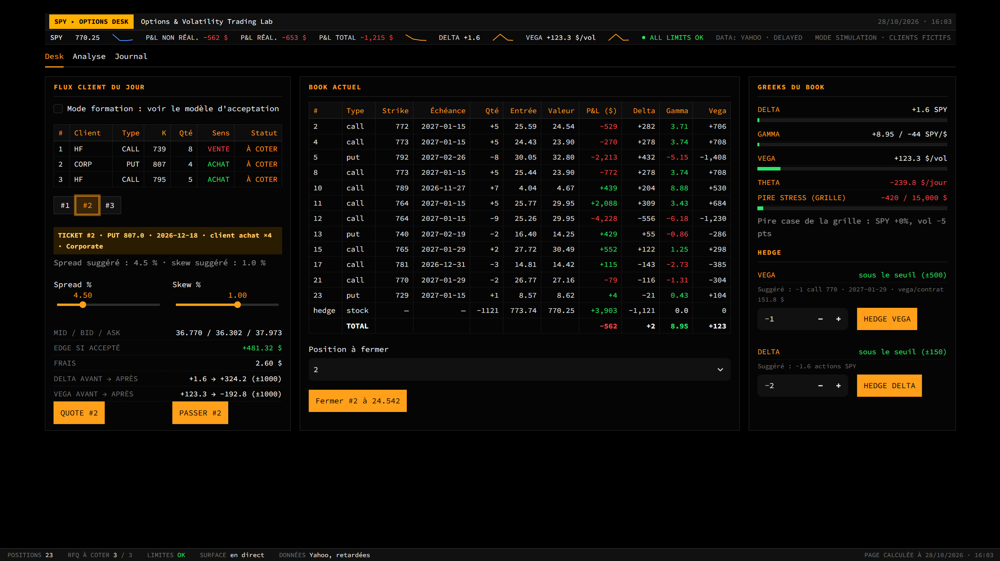

# Options & Volatility Trading Lab — Flow Desk Simulator

Un **desk de market making d'options simulé** sur le SPY, en Python / Streamlit.
Des clients simulés envoient des RFQ, le trader les cote (spread + skew), les clients acceptent ou vont voir ailleurs,
et le trader gère le book qui en résulte : Greeks, limites de risque, stress test, hedge delta et vega, P&L.

Les données de marché sont réelles (spot et chaînes d'options SPY via Yahoo Finance, **retardées**).
Les clients, leurs décisions et tous les trades sont **simulés** : aucun ordre réel n'est jamais envoyé.



---

## Ce que fait le desk

**Onglet Desk (un seul écran)**
- **Flux client** : un lot quotidien de RFQ (asset manager, corporate, hedge fund, fonds de vol).
  Un seul ticket ouvert à la fois : spread et skew suggérés, mid / bid / ask, edge attendu,
  contrôle pré-trade (delta et vega *avant → après*). Un trade qui dépasserait une limite
  *et* l'aggraverait est bloqué. Le trader peut aussi **passer** : la RFQ est enregistrée sans
  qu'aucune cotation soit envoyée, avec le prix qui aurait été coté (pour juger la décision après coup).
- **Book** : chaque position avec prix d'entrée, valeur, P&L, delta, **gamma** et vega, plus le
  hedge delta agrégé en actions et une ligne de total.
- **Risque** : delta, gamma, vega et theta nets, avec des barres qui montrent la part de chaque limite
  utilisée (dont la **limite de gamma court**), et la **pire case de la grille de stress** comparée à la limite de stress.
- **Hedge** : hedge vega suggéré (call ATM, échéance la plus proche de 90 jours) et hedge delta (actions).
  L'app indique si le hedge est justifié (au-delà d'un seuil, pour ne pas payer de frais inutilement) ;
  l'exécution reste au choix du trader.

**Onglet Analyse**
- **Cours du SPY** : graphique 1 jour, 5 jours, 1 mois, 3 mois ou 1 an, en ligne ou en chandeliers, avec ouverture, plus haut,
  plus bas, dernier, variation et volume ; infos au survol, zoom, séances collées (sans nuits ni week-ends).
  À côté : **vol réalisée sur 20 jours** face à la **vol implicite ATM à 30 jours** (prime de risque de variance).
- **Stress test** en heatmap : P&L du book pour un spot de −10 % à +10 % × une vol de −5 à +15 pts,
  calculé en **revalorisant chaque option**. Plus un scénario libre (spot, vol, jours) : le détail par
  grecque (delta / gamma / vega / theta) explique d'où vient le P&L, et le total en revalorisation donne
  le chiffre de référence. L'écart entre les deux montre ce que les grecques ne captent pas.
- **P&L** : non réalisé, réalisé, positions fermées, **markout par client** (spread capté face à ce que
  le marché a fait ensuite, avant et après le hedge delta), **statistiques des RFQ par client** (taux
  d'acceptation, spread moyen coté), historique quotidien et attribution du P&L.
- **Surface de volatilité** : heatmap (échéance × strike), structure par terme ATM et smile par échéance.

**Onglet Journal** : un carnet de trading où le trader note ce qu'il a fait et pourquoi, avec les Greeks du moment.

Un bandeau affiche le spot, le P&L, le delta et le vega avec leur historique récent, et un voyant d'état
(limites OK / hedge à faire / limite dépassée). Des notifications apparaissent quand une cotation est
acceptée ou refusée, quand l'état des limites change et quand une option arrive à échéance.

---

## Comment ça marche

| Sujet | Méthode |
|---|---|
| Pricing | Black-Scholes (européen). Greeks en unités de desk : delta en actions, gamma en actions par $, vega en $ par point de vol, theta en $ par jour (multiplicateur 100) |
| Vol implicite | Newton-Raphson sur les prix mid |
| Surface de vol | Calibrée **uniquement sur les options hors de la monnaie** : puts sous le spot (convertis par la parité call-put), calls au-dessus. Filtre de liquidité : bid > 0, strike à ±20 % du spot, spread relatif < 10 %. Interpolation linéaire entre les échéances |
| Cotation | bid / ask = mid × (1 ∓ spread / 2) × (1 + skew). Le skew décale la cotation pour gérer l'inventaire |
| Décision du client | La probabilité d'acceptation baisse à mesure que l'écart entre la cotation et le mid approche du seuil de tolérance du client. Chaque type de client a sa tolérance, sa taille et son sens. Une partie des clients est *informée* (elle connaît le mouvement du lendemain) : c'est ce que mesure le markout |
| Limites de risque | Dérivées d'un budget de perte de 5 000 $ : delta ±1 000 actions (choc de 5 $), vega ±1 000 $/vol (choc de 5 pts), **gamma court −44 actions/$** (½ × Γ × 15² = 5 000 $, soit un mouvement d'environ 2 %). Perte de stress 15 000 $ sur **toute la grille** (pire case). Seuils de hedge : delta 150, vega 500. Seul le gamma *court* est limité : le coût du gamma long est le theta, affiché à part |
| Stress test | **Revalorisation complète** : pour chaque case, chaque option est repricée en Black-Scholes avec le spot et la vol choqués, puis comparée à sa valeur modèle actuelle (modèle contre modèle, pour ne pas mélanger prix de marché et prix modèle). Le scénario libre fait vieillir les options du nombre de jours choisi |
| Vol réalisée | Écart-type des rendements logarithmiques quotidiens sur 20 séances, annualisé (× √252), comparé à la vol implicite ATM à 30 jours lue sur la surface |
| P&L | Spread capté + markout − frais. Valorisation au prix de marché sur la surface calibrée |
| Échéance | Le lendemain de l'échéance, les options sont réglées à leur valeur intrinsèque, avec la clôture du SPY du jour de l'échéance, et passent dans les positions fermées |

---

## Limites du modèle (simplifications connues)

- **Black-Scholes européen, sans dividende.** Les options SPY sont américaines et le SPY verse un dividende.
  Ignorer le dividende biaise légèrement les vols implicites ; l'exercice anticipé et le dividende pèsent
  surtout sur les options très dans la monnaie, c'est une des raisons pour lesquelles la surface n'utilise
  que des options hors de la monnaie.
- **Règlement en cash à l'échéance.** Les vraies options SPY se règlent en actions. Le P&L est le même si
  les actions livrées sont revendues à la clôture.
- **Stress en « sticky strike »** : quand le spot est choqué, chaque strike garde sa vol de la surface
  (décalée du choc de vol). En réalité le skew se déplace aussi avec le spot. Le choc de vol est parallèle :
  toutes les échéances bougent du même nombre de points.
- **Surface de vol simple** : interpolation linéaire entre les points de marché, sans modèle paramétrique
  (SVI, SABR) ni contrôle d'absence d'arbitrage.
- **Un seul chiffre de vega** : pas de vega par échéance, pas de vanna ni de volga.
- **Attribution du P&L partielle** : elle explique le delta, le gamma et le theta ; le vega, les nouveaux
  trades, les frais et les hedges tombent dans le résidu, qui peut être important.
- **Taux fixe à 5 %**, pas de courbe de taux.
- **Vol réalisée sur une fenêtre courte** (20 séances) : estimation bruitée, et comparaison d'un passé (réalisée) à une anticipation (implicite).
- **Données Yahoo retardées et parfois bruitées** : une partie du P&L quotidien est du bruit de valorisation
  (recalibration de la surface), pas du risque.
- **Clients stylisés** : un lot de RFQ par jour, un modèle d'acceptation simple, sans mémoire de la relation
  ni concurrence d'autres banques, et uniquement des options simples (pas de structures). Le contrôle pré-trade
  porte sur le delta et le vega, pas sur le gamma ni sur la limite de stress (ces limites sont vérifiées après le trade).
- Fermer une position la ferme toujours en entier (pas de fermeture partielle).

---

## Lancer l'application

```bash
git clone https://github.com/Sacha-Danthony/Trading-Lab.git
cd Trading-Lab
python -m venv venv
# Windows : venv\Scripts\activate    |    Mac / Linux : source venv/bin/activate
pip install -r requirements.txt
python -m streamlit run app.py
```

- Toujours lancer depuis le dossier du projet : `book.json`, `flow.json`, `journal.json`, `surface.json`,
  `historique.json`, `fermees.json` et `rfq_historique.json` y sont créés (et ne sont pas suivis par Git).
- Quand le marché américain est fermé (en général hors 15h30-22h, heure de Paris), l'app utilise la dernière surface
  sauvegardée. Au tout premier lancement, mieux vaut démarrer pendant la séance.
- `python reset.py` remet à zéro le book, le flux du jour et le journal.

---

## Fichiers

| Fichier | Rôle |
|---|---|
| `app.py` | Interface Streamlit (desk, analyse, journal) |
| `Pricing.py` | Prix et Greeks Black-Scholes |
| `data.py` | Spot, chaînes d'options, clôtures et historique de cours (yfinance), filtre de liquidité |
| `vol_surface.py` | Vol implicite, smile (options OTM), nettoyage des points aberrants, surface, interpolation |
| `book_greeks.py` | Greeks et valeur par position et pour le book, valeur modèle choquée (stress), taille du hedge delta |
| `book_store.py` | Book persistant, P&L réalisé / non réalisé, frais, règlement des échéances |
| `hedge_vega.py` | Instrument et taille du hedge vega |
| `flow.py`, `flow_store.py` | Génération et stockage des RFQ du jour, historique et statistiques des RFQ |
| `quoting.py` | Mid, bid / ask, décision du client, exécution, explication |
| `clients.py` | Profils de clients (tolérance au prix, taille, sens, information) |
| `limites.py` | Limites (delta, vega, gamma court, stress), contrôle pré-trade, grille de stress par revalorisation |
| `markout.py` | Spread capté et markout par client, spread suggéré |
| `historique.py` | Snapshots quotidiens du book et attribution du P&L jour par jour |
| `pnl.py` | Décomposition du P&L d'un scénario par les Greeks |
| `journal.py` | Carnet de trading |
| `simulation_clients.py` | Étude Monte Carlo du modèle client sur des rendements réels du SPY rééchantillonnés (résultats en % de la prime) |
| `couts.py`, `config.py`, `reset.py` | Frais, paramètres, remise à zéro |

---

## Prochaines étapes

- Tests automatiques (parité call-put, Greeks connus, stress)
- Vega par échéance, affichage de la vanna et du charm
- Contrôle pré-trade étendu au gamma et à la limite de stress
- Attribution du P&L complète (delta, gamma, vega, theta, edge client, résidu)
- RFQ qui arrivent pendant la journée (flux continu) et structures demandées par les clients
  (put spread, collar, risk reversal, straddle, calendar)
- Scénarios de stress cohérents (krach : spot en baisse et vol en hausse) et skew qui bouge avec le spot
- Fermeture partielle des positions
- Pricing américain avec dividendes (arbre binomial)
- Surface paramétrique (SVI) avec contrôle d'arbitrage
- Deuxième sous-jacent (QQQ) avec la corrélation dans le stress

---

*Projet pédagogique. Trading simulé uniquement : ce n'est pas un conseil en investissement.*
